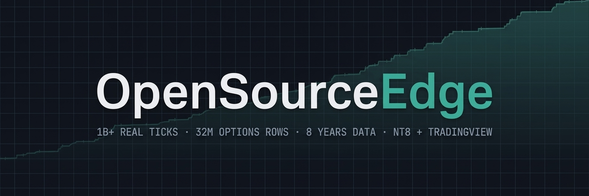

<p align="center">
  
</p>

# OpenSourceEdge

**Stop microing 1-minute candles when you have zero macro.**

Institutional options flows and intraday futures **Build Orders** explained in plain English, verified on real ticks, and open-sourced for `$0`.

- **Core Dataset:** 8 years of futures data (`2019 to 2026`), `1+ billion` real 1-tick fills, and `32 million` SPX/QQQ options rows.
- **Fog of War:** Strictly causal `T-1` signals only. Zero lookahead. No map hacks.
- **Platforms:** NinjaTrader 8 (`C#`) and TradingView (`PineScript v6`).
- **Price:** `$0`. No course. No Discord. No `$99/mo` 6-pool cheese.

Follow releases on X: **[@OpenSourceEdge](https://x.com/OpenSourceEdge)**

---

## Never Used GitHub Before? Start Here (30 Seconds)

You don't need to install Git or touch a terminal.

1. Click any Build Order file below (for example, [`LongGammaDrift_OpenSource.pine`](episodes/ep01-dealer-gamma/LongGammaDrift_OpenSource.pine)).
2. Click the **Copy** icon in the top-right corner of the code box.
3. Paste into **TradingView Pine Editor** (click **Add to chart**) or **NinjaTrader 8 NinjaScript Editor** (press **F5**).

*(Want a simpler page with 1-click Copy buttons? Open our beginner site at `https://open-source-edge.github.io/everything/` once GitHub Pages is live.)*

---

## Verified Build Orders (Free Code)

| Ep | Build Order Codename | Institutional Mechanism | NinjaTrader 8 | TradingView v6 | Guide & Proof |
|---:|---|---|---|---|---|
| **01** | **Shield Battery** *(Protoss)* | **Long-Gamma Afternoon Drift:** Buy `MNQ > VWAP` at `13:00 ET` only when `ES` opens above the pre-market SPX 14-DTE Gamma Flip (`+$9,711` 8y, 7 straight green yrs, `-$1,096` max DD, beat 1m bars on real 1-tick replay) | [`.cs`](episodes/ep01-dealer-gamma/LongGammaDrift_OpenSource.cs) | [`.pine`](episodes/ep01-dealer-gamma/LongGammaDrift_OpenSource.pine) | [Episode 01](episodes/ep01-dealer-gamma/README.md) |

*Upcoming Build Orders queued for release: **Stimpack** (First-5m One-Way Open), **Siege Tank** (Noise Band Breakout), **Blink Stalker** (Fast Morning MNQ-YM Scalp), **Yamato Cannon** (13:10 Treasury Post-Auction), **MULE Drop** (Turn-of-Month Flow), **Psionic Storm** (Short-Gamma Last Hour), and **Widow Mine** (QQQ Call-Euphoria Short).*

---

## The Strategy Graveyard (Fallen Units & 6-Pool Cheese)

Most retail trading folklore dies the second it gets scouted by 1-tick fills, realistic slippage, and blind out-of-sample years. Browse everything that tapped out with `GG` before risking `$1`:

- Read **[GRAVEYARD.md](GRAVEYARD.md)** (ICT/SMC, 1B+ ticks of CVD/Order Flow, 0DTE regime breaks, 9-market friction math, and our own caught map-hack lookahead bugs).

---

## Use It With AI

1. Open your AI. Recommended: **Gemini 4 Neon** at [gemini.google.com](https://gemini.google.com), which needs a Google AI Pro plan (free trial available). Any chat AI works.
2. Copy a prompt below and paste it in. For the first three, paste the strategy code underneath it (open the `.pine` or `.cs` file, click the copy icon). The website does this for you: https://open-source-edge.github.io/everything/#ai

**Explain it** (plain-English rules, the idea behind them and the risks)

```text
I'm new to trading. Below is the code for a futures trading strategy called Shield Battery. Explain it to me in plain English:

1. What it trades and at what time of day.
2. The exact rules for getting in and getting out.
3. Why it might work, and what "dealer gamma" means here.
4. What could go wrong, and roughly how much I could lose on a bad day trading 1 MNQ contract.

Define every trading term the first time you use it. Keep it short.
```

**Set it up in TradingView**

```text
I'm new to TradingView. Below is a Pine Script strategy. Walk me through adding it to a chart one step at a time, and wait for me to say "done" before you give the next step:

1. Open a 1-minute or 5-minute MNQ1! chart.
2. Paste the script into the Pine Editor and add it to the chart.
3. Open the Strategy Tester and explain what each number means.

If I paste an error message, tell me what caused it and give me the fixed code.
```

**Set it up in NinjaTrader 8**

```text
I'm new to NinjaTrader 8. Below is a NinjaScript strategy. Walk me through using it one step at a time, and wait for me to say "done" before you give the next step:

1. Create a new strategy in the NinjaScript Editor, paste this code and compile it.
2. Backtest it in the Strategy Analyzer on MNQ 1-minute data.
3. Run it on the Sim101 practice account only.

If I paste a compile error, tell me what caused it and give me the fixed code. Never tell me to turn it on with real money.
```

**Test your own idea** (type your idea at the end)

```text
I'm going to describe a trading idea. Act as a skeptical research partner whose job is to find out whether it's real before I risk any money:

1. Ask me who is forced to buy or sell, and why. If there's no clear reason, say so.
2. Help me test it on years of data I did not use to build it.
3. Include commissions and at least 1 tick of slippage on every entry and exit.
4. Check that flipping the rule makes it worse, that nudging each setting up or down by a third still works, and that it survives removing the 3 best days. If it fails any of these, tell me it failed.
5. Only if it survives, write it as a TradingView (Pine Script v6) and NinjaTrader 8 strategy with a hard stop and a 3:55 PM ET exit.

Be blunt. Don't tweak settings to make the results look better.

My idea:
```

---

## Disclaimer

Everything in this repository is educational quantitative research and open-source software (MIT License). Nothing here is financial advice. Simulated and historical backtests don't guarantee future live results. Always verify your broker or prop firm's automation rules before enabling live order execution.
