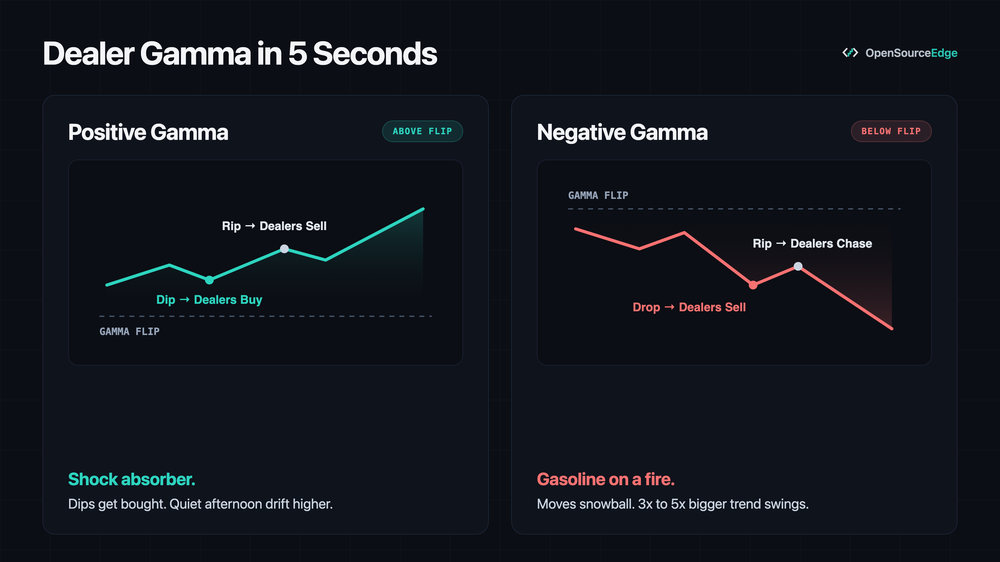

# Episode 01: Build Order `Shield Battery` (Dealer Gamma + 1:00 PM Nasdaq Drift)

**Race / Archetype:** Protoss (Options Plumbing & Volatility Shields)  
**Market:** `MNQ` (1-Minute)  
**License:** MIT (Free to use, fork, and break) by **[@OpenSourceEdge](https://x.com/OpenSourceEdge)**

<p align="center">
  
</p>

---

## Never Used GitHub Before? Copy in 30 Seconds

- **TradingView (1-Click Backtest or Manual Prop Alerts):** Click [`LongGammaDrift_OpenSource.pine`](LongGammaDrift_OpenSource.pine) -> click the **Copy** icon (top right) -> paste into TradingView **Pine Editor** -> click **Add to chart**.
- **NinjaTrader 8 (Automated / Sim):** Click [`LongGammaDrift_OpenSource.cs`](LongGammaDrift_OpenSource.cs) -> click **Copy** -> paste into `Documents\NinjaTrader 8\bin\Custom\Strategies\LongGammaDriftOpenSource.cs` -> open NinjaScript Editor and press **F5**. *(Or download the 1-click `.zip` from GitHub Releases -> `Tools > Import > NinjaScript Add-On`.)*

---

## Why It's Called `Shield Battery`

When `ES` opens above the pre-market `SPX` 14-DTE Gamma Flip (Positive Gamma), options market makers are mechanically forced to buy dips and sell rips. It works exactly like a **Protoss Shield Battery** recharging every dip while afternoon option decay quietly grinds Nasdaq higher into the `15:55 ET` close.

Drop below the Gamma Flip and the shields are gone. Dealers flip to selling into drops and chasing rips, turning the same 1:00 PM long rule into a bloodbath.

---

## The Exact Build Order (1 Check a Day, No Map Hacks)

1. **Pre-market macro:** `ES` opens at `09:30 ET` strictly ABOVE the causally mapped `SPX` 14-DTE Gamma Flip (Positive Gamma).
2. **Pause on Fed days:** Skip the 8 scheduled FOMC decision days a year.
3. **Entry (`13:00 ET`):** If `MNQ` closes above session RTH VWAP, buy `1 MNQ`.
4. **Stop loss:** Hard stop at `2.0 x ATR(15m)` (capped at 200 points).
5. **Exit:** Flat at `15:55 ET`. Zero overnight risk.

---

## 8-Year + Real 1-Tick Verification (`1 MNQ`, Real Slippage & `$1.24` RT Commissions)

<p align="center">
  
</p>

| Regime (Exact Same 13:00 ET Rule) | Trades | 8-Yr Net (`1 MNQ`) | Profit Factor | Win Rate | Max Drawdown | 2026 Virgin Holdout |
|---|---:|---:|---:|---:|---:|---:|
| **Above Gamma Flip (`Shield Battery` ON)** | `630` | **`+$9,711`** | **`1.37`** | **`57.5%`** | **`-$1,096`** | **`+$1,030`** (`7` straight green yrs) |
| **No Filter Control (All Days)** | `1,054` | `+$7,981` | `1.14` | `54.9%` | `-$3,667` | `-$2,468` |
| **Below Gamma Flip (Shields Offline)** | `424` | `-$1,730` | `0.95` | `51.2%` | `-$4,790` | `-$3,497` |

**Real 1-Tick Replay Parity Audit (`221` matched trades, `2023-2025`, `1B+` real MNQ ticks):**
- 1-Minute Bar Backtest: `+$1,736`
- Real 1-Tick Replay (`1t` slip): **`+$2,190`**
- Real Live Bid-Ask Spread (`1.42t` avg spread): **`+$2,144`** (`0.983` P&L correlation)

---

## NinjaTrader 8 Daily Regime CSV Format

Place your CSV at `Documents\NinjaTrader 8\OpenSourceEdge\daily_regime.csv` (see [`sample_daily_regime.csv`](sample_daily_regime.csv)):

```csv
date,spot_d1,d14_gamma_flip,all_gamma_flip,d14_net_gex_b,qqq_pcvol_p60,vix9d_vix,is_fomc
2026-11-23,5950.25,5915.00,5910.00,4.20,0.45,0.92,0
```

You can compute `d14_gamma_flip` pre-market for `$0/month` using a free brokerage options chain API (such as Charles Schwab Market Data API for `$SPX`) and standard Black-Scholes dealer gamma (`mult * gamma * OI * spot^2`), or supply `d14_net_gex_b > 0` as a fallback.

---

## Use It With AI

1. Open your AI. Recommended: **Gemini 4 Neon** at [gemini.google.com](https://gemini.google.com), which needs a Google AI Pro plan (free trial available). Any chat AI works.
2. Copy a prompt below and paste it in. For the first three, paste the strategy code underneath it (open the `.pine` or `.cs` file, click the copy icon). The website does this for you: https://open-source-edge.github.io/everything/#ai

**Explain it** (plain-English rules, the idea behind them and the risks)

```text
I'm new to trading. Below is the code for a futures trading strategy called Shield Battery. Explain it to me in plain English:

1. What it trades and at what time of day.
2. The exact rules for getting in and getting out.
3. Why it might work, and what "dealer gamma" means here.
4. What could go wrong, and roughly how much I could lose on a bad day trading 1 MNQ contract.

Define every trading term the first time you use it. Keep it short.
```

**Set it up in TradingView**

```text
I'm new to TradingView. Below is a Pine Script strategy. Walk me through adding it to a chart one step at a time, and wait for me to say "done" before you give the next step:

1. Open a 1-minute MNQ1! chart.
2. Paste the script into the Pine Editor and add it to the chart.
3. Open the Strategy Tester and explain what each number means.

If I paste an error message, tell me what caused it and give me the fixed code.
```

**Set it up in NinjaTrader 8**

```text
I'm new to NinjaTrader 8. Below is a NinjaScript strategy. Walk me through using it one step at a time, and wait for me to say "done" before you give the next step:

1. Create a new strategy in the NinjaScript Editor, paste this code and compile it.
2. Backtest it in the Strategy Analyzer on MNQ 1-minute data.
3. Run it on the Sim101 practice account only.

If I paste a compile error, tell me what caused it and give me the fixed code. Never tell me to turn it on with real money.
```

**Test your own idea** (type your idea at the end)

```text
I'm going to describe a trading idea. Act as a skeptical research partner whose job is to find out whether it's real before I risk any money:

1. Ask me who is forced to buy or sell, and why. If there's no clear reason, say so.
2. Help me test it on years of data I did not use to build it.
3. Include commissions and at least 1 tick of slippage on every entry and exit.
4. Check that flipping the rule makes it worse, that nudging each setting up or down by a third still works, and that it survives removing the 3 best days. If it fails any of these, tell me it failed.
5. Only if it survives, write it as a TradingView (Pine Script v6) and NinjaTrader 8 strategy with a hard stop and a 3:55 PM ET exit.

Be blunt. Don't tweak settings to make the results look better.

My idea:
```

---

*Disclaimer: Quantitative research and open-source educational code only. Not financial advice. Verify broker and prop-firm rules before running automated execution.*
