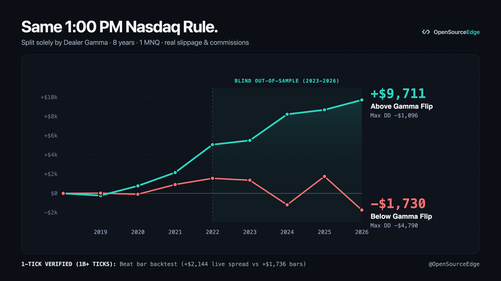

# Episode 01: Build Order `Shield Battery` (Dealer Gamma + 1:00 PM Nasdaq Drift)

**Race / Archetype:** Protoss (Options Plumbing & Volatility Shields)  
**Market:** `MNQ` (1-Minute)  
**License:** MIT (Free to use, fork, and break) by **[@OpenSourceEdge](https://x.com/OpenSourceEdge)**

<p align="center">
  
</p>

---

## Never Used GitHub Before? Copy in 30 Seconds

- **TradingView (1-Click Backtest or Manual Prop Alerts):** Click [`LongGammaDrift_OpenSource.pine`](LongGammaDrift_OpenSource.pine) -> click the **Copy** icon (top right) -> paste into TradingView **Pine Editor** -> click **Add to chart**.
- **NinjaTrader 8 (Automated / Sim):** Click [`LongGammaDrift_OpenSource.cs`](LongGammaDrift_OpenSource.cs) -> click **Copy** -> paste into `Documents\NinjaTrader 8\bin\Custom\Strategies\LongGammaDriftOpenSource.cs` -> open NinjaScript Editor and press **F5**. *(Or download the 1-click `.zip` from GitHub Releases -> `Tools > Import > NinjaScript Add-On`.)*

---

## Why It's Called `Shield Battery`

When `ES` opens above the pre-market `SPX` 14-DTE Gamma Flip (Positive Gamma), options market makers are mechanically forced to buy dips and sell rips. It works exactly like a **Protoss Shield Battery** recharging every dip while afternoon option decay quietly grinds Nasdaq higher into the `15:55 ET` close.

Drop below the Gamma Flip and the shields are gone. Dealers flip to selling into drops and chasing rips, turning the same 1:00 PM long rule into a bloodbath.

---

## The Exact Build Order (1 Check a Day, No Map Hacks)

1. **Pre-market macro:** `ES` opens at `09:30 ET` strictly ABOVE the causally mapped `SPX` 14-DTE Gamma Flip (Positive Gamma).
2. **Pause on Fed days:** Skip the 8 scheduled FOMC decision days a year.
3. **Entry (`13:00 ET`):** If `MNQ` closes above session RTH VWAP, buy `1 MNQ`.
4. **Stop loss:** Hard stop at `2.0 x ATR(15m)` (capped at 200 points).
5. **Exit:** Flat at `15:55 ET`. Zero overnight risk.

---

## 8-Year + Real 1-Tick Verification (`1 MNQ`, Real Slippage & `$1.24` RT Commissions)

<p align="center">
  
</p>

| Regime (Exact Same 13:00 ET Rule) | Trades | 8-Yr Net (`1 MNQ`) | Profit Factor | Win Rate | Max Drawdown | 2026 Virgin Holdout |
|---|---:|---:|---:|---:|---:|---:|
| **Above Gamma Flip (`Shield Battery` ON)** | `630` | **`+$9,711`** | **`1.37`** | **`57.5%`** | **`-$1,096`** | **`+$1,030`** (`7` straight green yrs) |
| **No Filter Control (All Days)** | `1,054` | `+$7,981` | `1.14` | `54.9%` | `-$3,667` | `-$2,468` |
| **Below Gamma Flip (Shields Offline)** | `424` | `-$1,730` | `0.95` | `51.2%` | `-$4,790` | `-$3,497` |

**Real 1-Tick Replay Parity Audit (`221` matched trades, `2023-2025`, `1B+` real MNQ ticks):**
- 1-Minute Bar Backtest: `+$1,736`
- Real 1-Tick Replay (`1t` slip): **`+$2,190`**
- Real Live Bid-Ask Spread (`1.42t` avg spread): **`+$2,144`** (`0.983` P&L correlation)

---

## NinjaTrader 8 Daily Regime CSV Format

Place your CSV at `Documents\NinjaTrader 8\OpenSourceEdge\daily_regime.csv` (see [`sample_daily_regime.csv`](sample_daily_regime.csv)):

```csv
date,spot_d1,d14_gamma_flip,all_gamma_flip,d14_net_gex_b,qqq_pcvol_p60,vix9d_vix,is_fomc
2026-11-23,5950.25,5915.00,5910.00,4.20,0.45,0.92,0
```

You can compute `d14_gamma_flip` pre-market for `$0/month` using a free brokerage options chain API (such as Charles Schwab Market Data API for `$SPX`) and standard Black-Scholes dealer gamma (`mult * gamma * OI * spot^2`), or supply `d14_net_gex_b > 0` as a fallback.

---

## Copy-Paste AI Remix Prompt (Gemini 4 Neon)

```markdown
Here's the Shield Battery (Long-Gamma Afternoon Drift) strategy (NinjaScript / PineScript).

Do one of the following based on what I ask next:
1. PORT: Translate this exact logic into [Python / Sierra Chart ACSIL / TradeStation EasyLanguage / QuantConnect] with zero lookahead (no map hacks), a 2.0x ATR(15m) hard stop, FOMC skip, and a 15:55 ET session flatten.
2. STRESS-TEST: Write a Python validation script for my own futures + GEX CSV data that tests:
   - 1-tick and 2-tick slippage per side plus realistic commissions
   - Year-by-year net profit and max drawdown
   - Opposite-regime placebo (Open < Gamma Flip)
   - Time plateau (12:30, 12:45, 13:00, 13:15 ET) and stop plateau (1.5x to 2.5x ATR)
   - Outlier check (strip the top 3 best days)

Don't optimize parameters to make the equity curve prettier. Tell me bluntly if it breaks.
```

---

*Disclaimer: Quantitative research and open-source educational code only. Not financial advice. Verify broker and prop-firm rules before running automated execution.*
